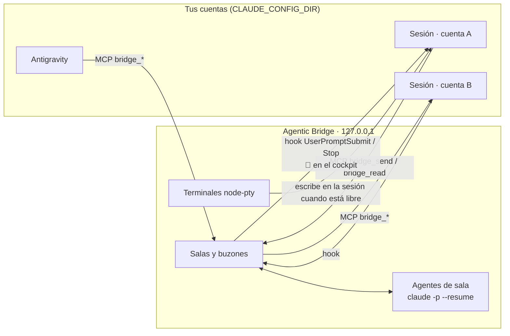

<p align="center"></p>

<h1 align="center">Agentic Bridge</h1>
<p align="center"><b>El editor web4.</b> Tus agentes y todas tus cuentas, en un solo puente.</p>

---

Agentic Bridge es un editor local que reúne en un solo lugar **todas las sesiones de Claude Code y Antigravity de tu equipo**, aunque vivan en cuentas distintas. Además las hace trabajar juntas: salas donde agentes con rol (supervisor, arquitecto, desarrolladores, QA…) conversan contigo y entre ellos, terminales integradas con tu cockpit, visor de archivos y carpetas, proyectos con un **contrato que se cumple** y métricas de cada suscripción.

Todo corre en tu máquina (`127.0.0.1`). No hay nube intermedia.

## ¿Por qué web4?

Web1 te dejó **leer**. Web2, **escribir**. Web3, **poseer**. Web4 es **delegar**: humanos y agentes en el mismo espacio, con memoria, roles, reglas escritas y guardas que una máquina hace cumplir.

## Qué trae

| | |
|---|---|
| **Centro de mando** | Sesiones vivas, agentes trabajando, uso de cada suscripción y atajos, todo en una pantalla. `Ctrl K` abre la paleta de comandos. |
| **Sesiones** | Todas las sesiones de Claude Code y Antigravity de todas tus cuentas (`CLAUDE_CONFIG_DIR`), en vivo: estado, carpeta, rama, modelo, contexto, costo, tokens y último mensaje. Renómbralas, léeles la conversación, escríbeles, agrégalas a una sala o retómalas. |
| **Salas** | Chat de grupo entre tú, agentes con rol y sesiones en vivo. Menciones con `@handle`, imágenes pegadas con `Ctrl+V`, archivos arrastrados, citas, coordinador, presupuesto y límite de turnos automáticos entre agentes. |
| **Terminales** | Sesiones reales de Claude Code (con tu statusline/cockpit) y PowerShell dentro del editor. `Ctrl+V` pega texto o una imagen del portapapeles. Bridge puede despertar una sesión integrada cuando le llega un mensaje. |
| **Archivos** | Árbol de carpetas, vista de carpeta en cuadrícula o lista, visor con resaltado de sintaxis, markdown renderizado, imágenes, PDF y edición ligera (`Ctrl+S`). Comparte cualquier archivo en una sala. |
| **Proyectos** | Asistente de 3 pasos (proyecto, equipo y contrato) que crea la carpeta, `CONTRATO.md`, `.bridge/contract.json`, `todo.md`, los subagentes en `.claude/agents/` y la sala del equipo. El tablero kanban se lee en vivo desde `todo.md`. |
| **Equipo** | Biblioteca de roles editable: instrucciones, modelo, permisos y herramientas permitidas. Despliega cualquier rol como sesión o agente de sala. |
| **Métricas** | Uso de la ventana de 5 horas y de la semana por suscripción, con hora de reinicio; costo y tokens por sesión; tabla completa ordenable. |

## Cómo se hablan las sesiones



- **MCP `agentic-bridge`**: cada sesión, de cualquier cuenta, obtiene las herramientas `bridge_whoami`, `bridge_sessions`, `bridge_rooms`, `bridge_read`, `bridge_send` y `bridge_join`.
- **Hooks de buzón**: `UserPromptSubmit` entrega los mensajes pendientes como contexto. Con `Stop`, si llegó algo mientras la sesión trabajaba, se le pide responder antes de detenerse (una sola vez).
- **Agentes de sala**: cada agente es una sesión de Claude con memoria propia que Bridge conduce turno a turno (`claude -p --output-format stream-json --resume`). Se activan con `@menciones`, con un tope de turnos automáticos y de presupuesto.
- **Cockpit**: el statusline (en `integrations/cockpit/`) publica su estado en `~/.claude/crew/` y muestra `📨 N` cuando hay mensajes de Bridge.

## Empezar

Requisitos: **Node 20+** y **Claude Code** instalado (`claude` en el PATH). Probado en Windows 11; Antigravity es opcional.

```powershell
git clone https://github.com/DevCristobalvc/agentic-bridge-editor.git
cd agentic-bridge-editor
npm install
npm start            # o doble clic en "Iniciar Agentic Bridge.cmd"
```

Se abre `http://127.0.0.1:4004`. En el inicio aparece **Conectar ahora** (o ejecuta `npm run connect`). Para cada cuenta encontrada en tu carpeta de usuario (`~/.claude*`) y para Antigravity:

1. registra el servidor MCP `agentic-bridge` con `claude mcp add -s user`,
2. agrega los hooks de buzón y guardas a `settings.json` (con copia en `backups/`),
3. instala la skill `/modo-todo`.

Es idempotente: puedes repetirlo sin duplicar nada.

## Modo todo.md

No se crean tareas una por una. Se escribe **una vez** el contrato del trabajo y el equipo lo ejecuta:

- **`CONTRATO.md`**: objetivo, alcance, equipo y responsabilidades, protocolo de comunicación, reglas, guardas, hooks, límites, definición de hecho y escalamiento.
- **`.bridge/contract.json`**: la parte que se hace cumplir. El hook `guard.js` (`PreToolUse`) bloquea ediciones en rutas protegidas (globs) y comandos prohibidos (texto o `/regex/`) en **cualquier sesión conectada de cualquier cuenta**, y le explica al agente por qué.
- **`todo.md`**: el tablero, en el formato que leen el cockpit y el kanban de Bridge:

```markdown
## T01. Crear el esquema de facturas
- **Status:** in-progress
- **Owner:** @desarrollador-1
- **Description:** Tablas e índices para facturas y clientes.
- **Acceptance criteria:**
  - [x] Migración aplicada
  - [ ] Datos de prueba
```

Actívalo desde un proyecto (**Modo todo.md**) o en cualquier terminal con `/modo-todo`.

## Seguridad

- El servidor solo escucha en `127.0.0.1`, rechaza otros `Host` (protección contra DNS rebinding) y otros `Origin`, y exige un token local (`~/.agentic-bridge/token`) en cada llamada a la API y al WebSocket.
- Markdown sanitizado con DOMPurify; los SVG y documentos se sirven con una CSP que impide ejecutar scripts.
- Las guardas del contrato se aplican en cualquier modo de permisos, incluso "sin preguntas".
- Conectar cuentas hace copia de cada `settings.json` antes de modificarlo.
- Los datos de Bridge (salas, buzones, roles, adjuntos) viven en `~/.agentic-bridge/`, fuera del repositorio.

## Estructura

```
server/          hub: API, WebSocket, sesiones, salas, agentes, terminales, archivos, proyectos
integrations/
  mcp/           servidor MCP stdio con las herramientas bridge_*
  hooks/         inbox.js (UserPromptSubmit + Stop) y guard.js (PreToolUse)
  skills/        modo-todo/SKILL.md
  cockpit/       statusline con tablero compartido e indicador 📨
web/             interfaz (Preact + htm, sin paso de compilación), xterm.js
scripts/         connect.js, check.js
```

## Hoja de ruta

- Diffs y revisión de cambios por tarea desde el tablero.
- Paso a paso de un agente (herramientas, archivos tocados) en vivo dentro de la sala.
- Conector A2A para agentes en otras máquinas.
- Empaquetado como app de escritorio.

## Licencia

MIT
