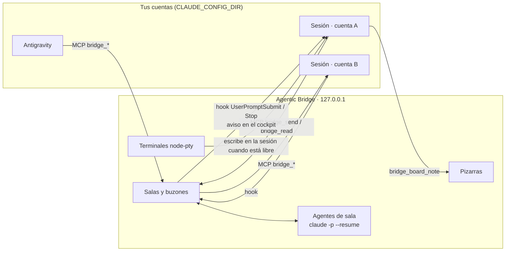

<p align="center"></p>

<h1 align="center">Agentic Bridge</h1>
<p align="center"><b>El editor web4.</b> Tus agentes y todas tus cuentas, en un solo puente.</p>

---

Agentic Bridge es un editor local que reúne en un solo lugar **todas las sesiones de Claude Code y Antigravity de tu equipo**, aunque vivan en cuentas distintas, y las pone a trabajar juntas:

- salas donde agentes con rol (supervisor, arquitecto, desarrolladores, QA…) conversan contigo y entre ellos;
- terminales integradas con tu cockpit: Claude, Antigravity, PowerShell, Git Bash, CMD y WSL;
- una **pizarra Excalidraw** que en cada proyecto es también su kanban;
- proyectos con un **contrato que se cumple**;
- el historial completo de tus conversaciones;
- tus cuentas de desarrollo y credenciales en un solo lugar;
- métricas de cada suscripción.

Todo corre en tu máquina (`127.0.0.1`). No hay nube intermedia.

## ¿Por qué web4?

Web1 te dejó **leer**. Web2, **escribir**. Web3, **poseer**. Web4 es **delegar**: humanos y agentes en el mismo espacio, con memoria, roles, reglas escritas y guardas que una máquina hace cumplir.

## Qué trae

| | |
|---|---|
| **Centro de mando** | Muestra en una pantalla las sesiones vivas, los agentes trabajando, el uso de cada suscripción y la sección "continuar donde quedaste". `Ctrl K` abre la paleta de comandos. |
| **Sesiones** | Todas las sesiones de Claude Code y Antigravity de todas tus cuentas (`CLAUDE_CONFIG_DIR`), en vivo: estado, carpeta, rama, modelo, contexto, costo, tokens y último mensaje. Puedes renombrarlas, leer su conversación, escribirles, agregarlas a una sala o retomarlas. |
| **Salas** | Chat de grupo entre tú, agentes con rol y sesiones en vivo de Claude o Antigravity. Incluye menciones con `@handle`, imágenes pegadas con `Ctrl+V`, archivos arrastrados, citas, coordinador, presupuesto y límite de turnos automáticos. |
| **Terminales** | Claude Code y Antigravity (`agy`) reales, con tu cockpit, más PowerShell, Git Bash, CMD y WSL. Puedes pasarles credenciales como variables de entorno y renombrar las pestañas con doble clic. Bridge despierta a una sesión integrada cuando le llega un mensaje. |
| **Historial** | Todas las conversaciones de todas tus cuentas y de Antigravity. Puedes agruparlas por fecha, filtrarlas, **buscar dentro del contenido** y abrirlas en un lector completo (con herramientas y resultados) para retomarlas, exportarlas a Markdown o guardarlas en el Baúl. |
| **Proyectos** | Un asistente de 3 pasos (proyecto, equipo y contrato) crea `CONTRATO.md`, `.bridge/contract.json`, `todo.md`, los subagentes y la sala del equipo. Cada proyecto tiene pizarra, tablero de tareas con arrastrar y soltar, detalle de tarea con "trabajar en esta tarea", conversaciones de su carpeta, contrato y guardas. |
| **Pizarras** | **Excalidraw completo** (el editor de excalidraw.com): formas, flechas, texto a mano, imágenes, biblioteca y exportación. Se guarda solo. En un proyecto, las columnas y tarjetas vienen de `todo.md`: si arrastras una tarjeta, su estado se escribe en el archivo, y si un agente cambia el archivo, la tarjeta se mueve sola. Los archivos `.excalidraw` se abren igual. |
| **Archivos** | Árbol de carpetas, **carpetas favoritas**, archivos recientes, vista de carpeta en cuadrícula o lista, y visor con resaltado de sintaxis, markdown, imágenes, PDF y edición ligera (`Ctrl+S`). Desde cualquier carpeta abres una terminal o un agente. |
| **Equipo** | Biblioteca de roles editable: icono, instrucciones, modelo, permisos y herramientas permitidas. |
| **Baúl** | Memoria compartida: notas, fragmentos e imágenes con etiquetas, que guardas tú o cualquier sesión (`bridge_vault_save`) y que todas pueden buscar (`bridge_vault_search`). |
| **Cuentas** | Tus suscripciones de Claude (y crear una nueva cuenta), Antigravity, y las cuentas de **GitHub, Vercel, Azure, Docker, npm, Git, SSH, Kubernetes, AWS, Google Cloud, Supabase, Netlify, Cloudflare, Firebase, Fly.io y Railway**, leídas de sus propios CLI. Puedes iniciar o cerrar sesión, cambiar de cuenta o de suscripción, y guardar **credenciales cifradas**. |
| **Métricas** | Valor equivalente en API día a día, tokens, días activos y racha. Mapa de cuándo trabajas, uso por modelo, proyecto, cuenta y herramienta, más la ventana de 5 horas y la semana de cada suscripción, con su historial. |

## Cómo se hablan las sesiones



- **MCP `agentic-bridge`**: cada sesión, de cualquier cuenta, tiene estas herramientas:
  - `bridge_whoami`, `bridge_sessions` y `bridge_rooms`;
  - `bridge_read`, `bridge_send` y `bridge_join`;
  - `bridge_vault_save` y `bridge_vault_search`;
  - `bridge_board_read` y `bridge_board_note`;
  - `bridge_room_invite` y `bridge_room_create_agent`, solo para quien coordina una sala: invita sesiones abiertas o crea agentes con un rol.
- **Hooks de buzón**: `UserPromptSubmit` entrega los mensajes pendientes como contexto. Con `Stop`, si llegó algo mientras la sesión trabajaba, le pide responder antes de detenerse (una sola vez).
- **Despertar una sesión en espera**: cuando mencionas a una sesión que no está trabajando, Bridge le escribe un aviso corto para que lea su buzón.
  - Si la sesión está en una terminal del editor, lo escribe ahí.
  - Si está en otra terminal (Git Bash, Windows Terminal, VS Code, PowerShell), lo escribe en su consola (solo en Windows).
  - En ambos casos solo escribe si el cuadro de entrada de Claude Code está vacío: un texto a medio escribir o un diálogo abierto no se tocan, y lo reintenta más tarde.
  - Los mensajes en sí nunca se teclean: llegan por el hook. Se apaga en Ajustes.

  Claude Code tiene un mecanismo propio para esto, los [channels](https://code.claude.com/docs/en/channels). Está en vista previa y viene apagado en los planes Team y Enterprise hasta que el dueño de la organización lo activa.
- **Entrega mientras la sesión trabaja**: se activa en Ajustes y es opcional. Un hook `PostToolUse` entrega los mensajes entre una herramienta y la siguiente. Sin pendientes no hace llamadas de red, y no lee claves ni toca nada interno de Claude Code.
- **Agentes de sala**: cada agente es una sesión de Claude con memoria propia que Bridge conduce turno a turno (`claude -p --output-format stream-json --resume`). Se activan con `@menciones`, con un tope de turnos automáticos y de presupuesto.
- **Cockpit**: el statusline (en `integrations/cockpit/`) publica su estado en `~/.claude/crew/` y avisa cuando hay mensajes de Bridge.

## Empezar

Requisitos:

- **Node 22+**, que trae `node:sqlite` para leer el historial de Antigravity; Node 20 también sirve, pero sin ese historial.
- **Claude Code** instalado.

Probado en Windows 11. Antigravity y Git for Windows son opcionales.

```powershell
git clone https://github.com/DevCristobalvc/agentic-bridge-editor.git
cd agentic-bridge-editor
npm install
npm link             # una vez: instala el comando abe-on
abe-on               # desde cualquier terminal: levanta el hub y abre el editor
```

`abe-on` funciona en Git Bash, PowerShell y CMD. Si el hub ya está corriendo, solo abre el editor; si no, lo arranca en segundo plano (sin ventana, con el registro en `~/.agentic-bridge/hub.log`) y espera a que responda. Con `abe-on --no-open` no abre el navegador. También puedes usar `npm start` o hacer doble clic en `Iniciar Agentic Bridge.cmd`.

Se abre `http://127.0.0.1:4004`. En el inicio aparece **Conectar ahora**; también puedes ejecutar `npm run connect`. Para cada cuenta encontrada en tu carpeta de usuario (`~/.claude*`) y para Antigravity:

1. registra el servidor MCP `agentic-bridge` con `claude mcp add -s user`,
2. agrega los hooks de buzón y guardas a `settings.json` (con copia en `backups/`),
3. instala la skill `/modo-todo`.

Es idempotente: puedes repetirlo sin duplicar nada.

## Modo todo.md

No se crean tareas una por una. Se escribe **una vez** el contrato del trabajo y el equipo lo ejecuta:

- **`CONTRATO.md`**: objetivo, alcance, equipo y responsabilidades, protocolo de comunicación, reglas, guardas, hooks, límites, definición de hecho y escalamiento.
- **`.bridge/contract.json`**: la parte que se hace cumplir. El hook `guard.js` (`PreToolUse`) bloquea ediciones en rutas protegidas (globs) y comandos prohibidos (texto o `/regex/`) en **cualquier sesión conectada de cualquier cuenta**, y le explica al agente por qué.
- **`todo.md`**: el tablero, en el formato que leen el cockpit, el kanban de tareas y la pizarra:

```markdown
## T01. Crear el esquema de facturas
- **Status:** in-progress
- **Owner:** @desarrollador-1
- **Description:** Tablas e índices para facturas y clientes.
- **Acceptance criteria:**
  - [x] Migración aplicada
  - [ ] Datos de prueba
```

Actívalo desde un proyecto (**Modo todo.md**) o en cualquier terminal con `/modo-todo`.

La pizarra del proyecto se guarda en `.bridge/board.excalidraw`, un archivo estándar de Excalidraw que también abre en excalidraw.com.

## Seguridad

- **Red local:** el servidor solo escucha en `127.0.0.1` y rechaza otros `Host` (protección contra DNS rebinding) y otros `Origin`. Exige un token local (`~/.agentic-bridge/token`) en cada llamada a la API y al WebSocket.
- **Credenciales:** se cifran con AES-256-GCM, y la llave maestra queda protegida con DPAPI de Windows. Una copia de esos archivos no sirve en otro equipo ni con otro usuario de Windows. Bridge nunca se las pasa a los agentes (ni por las salas ni por las herramientas `bridge_*`): solo salen cuando las revelas en el editor o como variables de entorno de una terminal que tú abres. Como pasa con cualquier secreto guardado para tu usuario, un programa que corra con tu mismo usuario de Windows podría abrirlas.
- **Cuentas externas:** Bridge las lee de sus propios CLI y no guarda sus tokens. Iniciar o cerrar sesión ejecuta el comando oficial de cada CLI en una terminal que ves.
- **Contenido:** el Markdown se sanitiza con DOMPurify, y los SVG y documentos se sirven con una CSP que impide ejecutar scripts.
- **Guardas:** las del contrato se aplican en cualquier modo de permisos, incluso "sin preguntas".
- **Datos:** conectar cuentas hace copia de cada `settings.json` antes de modificarlo. Los datos de Bridge (salas, buzones, roles, adjuntos, pizarras libres, índice del historial) viven en `~/.agentic-bridge/`, fuera del repositorio.

## Estructura

```
server/          hub: API, WebSocket, sesiones, salas, agentes, terminales, archivos,
                 proyectos, pizarras, historial, cuentas y credenciales
integrations/
  mcp/           servidor MCP stdio con las herramientas bridge_*
  hooks/         inbox.js (UserPromptSubmit + Stop) y guard.js (PreToolUse)
  skills/        modo-todo/SKILL.md
  cockpit/       statusline con tablero compartido y aviso de Bridge
web/             interfaz (Preact + htm, sin paso de compilación), xterm.js, Excalidraw
scripts/         connect.js, check.js
```

## Hoja de ruta

- Diffs y revisión de cambios por tarea desde el tablero.
- Paso a paso de un agente (herramientas, archivos tocados) en vivo dentro de la sala.
- Conector A2A para agentes en otras máquinas.
- Empaquetado como app de escritorio.

## Licencia

MIT. Incluye [Excalidraw](https://github.com/excalidraw/excalidraw) (MIT) como dependencia.
